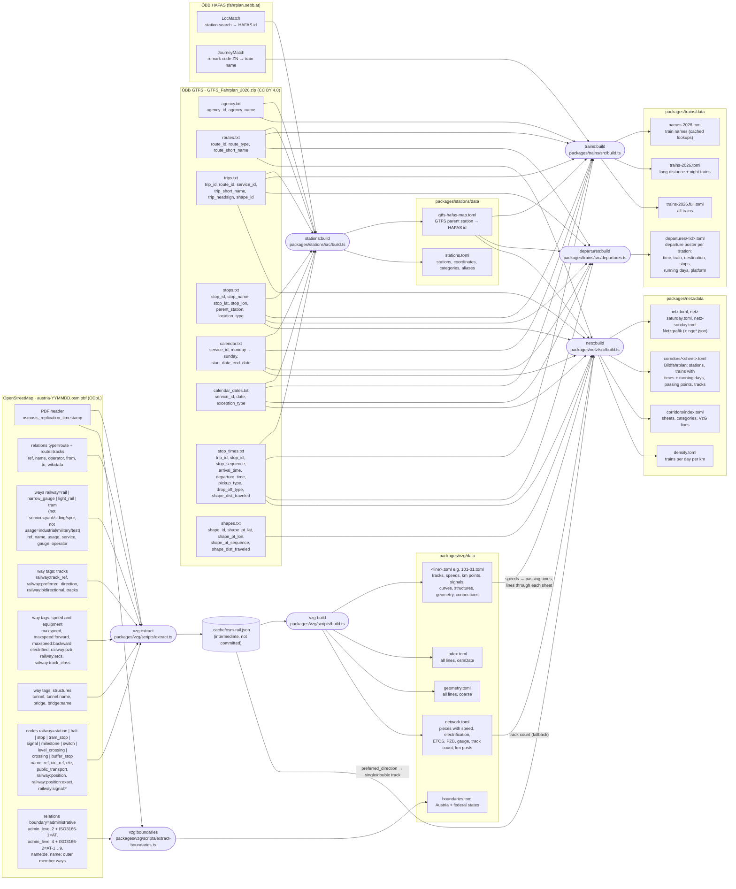

# Data flow: how the committed TOML files are built

Every file under `packages/*/data/` is generated by a build script from three sources: the ÖBB **GTFS** (individual `.txt` files), **OpenStreetMap** (Geofabrik PBF; the keys/tags read), and a few **HAFAS** lookups. Left: the input files and tags; middle: the scripts (`vp run …`); right: the output files. Licences and fetch dates: [README → Data & licences](../README.md#data--licences).

## What comes from where

| Output                               | GTFS                                                                                                                                                           | OSM keys/tags                                                                                                                                                                                                                                                                                                                                       | Other                                                               |
| ------------------------------------ | -------------------------------------------------------------------------------------------------------------------------------------------------------------- | --------------------------------------------------------------------------------------------------------------------------------------------------------------------------------------------------------------------------------------------------------------------------------------------------------------------------------------------------- | ------------------------------------------------------------------- |
| `stations/data/stations.toml`        | `stops.txt` (names, coordinates, parent stations), `routes.txt` `route_type` (rail only), `trips.txt` + `stop_times.txt` (departures, categories)              | –                                                                                                                                                                                                                                                                                                                                                   | HAFAS ids from `gtfs-hafas-map.toml`                                |
| `stations/data/gtfs-hafas-map.toml`  | `stops.txt` (name, coordinates)                                                                                                                                | –                                                                                                                                                                                                                                                                                                                                                   | HAFAS `LocMatch`, scored by name and distance                       |
| `trains/data/trains-2026*.toml`      | `trips.txt` (`trip_short_name` → category + number, `trip_headsign`), `stop_times.txt`, `calendar.txt` + `calendar_dates.txt` (running days)                   | –                                                                                                                                                                                                                                                                                                                                                   | station ids via `gtfs-hafas-map.toml`, names from `names-2026.toml` |
| `trains/data/names-2026.toml`        | (trains from the build)                                                                                                                                        | –                                                                                                                                                                                                                                                                                                                                                   | HAFAS `JourneyMatch`, remark code `ZN`                              |
| `trains/data/departures/<id>.toml`   | `stop_times.txt` (departures, `pickup_type`), `trips.txt` (train), `stops.txt` (`platform_code`, parent station), `calendar*.txt` (running days)               | –                                                                                                                                                                                                                                                                                                                                                   | station ids via `gtfs-hafas-map.toml`                               |
| `vzg/data/<line>.toml`, `index.toml` | –                                                                                                                                                              | `route=tracks` relations (`ref`, `name`, `operator`, `from`, `to`, `wikidata`); ways (`ref`, `railway`, `usage`, `service`, `railway:track_ref`, `railway:preferred_direction`, `maxspeed*`, `tunnel*`, `bridge*`, `gauge`); nodes (`railway`, `railway:position*`, `name`, `uic_ref`, `ele`, `railway:signal:*`); PBF header timestamp → `osmDate` | –                                                                   |
| `vzg/data/network.toml`              | –                                                                                                                                                              | as above, plus `electrified`, `railway:etcs`, `railway:pzb`, `operator`; track count = `railway:preferred_direction` forward/backward                                                                                                                                                                                                               | –                                                                   |
| `vzg/data/geometry.toml`             | –                                                                                                                                                              | way geometry of the line paths                                                                                                                                                                                                                                                                                                                      | –                                                                   |
| `vzg/data/boundaries.toml`           | –                                                                                                                                                              | `boundary=administrative`, `admin_level`, `ISO3166-1`, `ISO3166-2`, `name:de`, `name`                                                                                                                                                                                                                                                               | –                                                                   |
| `netz/data/netz*.toml`, `nge*.json`  | `trips.txt`, `stop_times.txt`, `stops.txt`, `calendar*.txt` (one day per day type)                                                                             | –                                                                                                                                                                                                                                                                                                                                                   | HAFAS ids from `gtfs-hafas-map.toml`                                |
| `netz/data/corridors/*.toml`         | whole year: `trips.txt`, `stop_times.txt` (incl. `shape_dist_traveled`), `calendar*.txt` → running-day bitsets; `shapes.txt` → passing points and track counts | `ref` + `railway:preferred_direction` of the sheet's lines (via `.cache/osm-rail.json`)                                                                                                                                                                                                                                                             | VzG speeds (`<line>.toml`) weight the passing times; HAFAS ids      |
| `netz/data/corridors/index.toml`     | reference day: categories, trains per day                                                                                                                      | VzG lines through the sheet's stations                                                                                                                                                                                                                                                                                                              | –                                                                   |
| `netz/data/density.toml`             | trips of the reference day, `shapes.txt` sampled every 500 m                                                                                                   | km posts of the VzG lines (`railway:position`)                                                                                                                                                                                                                                                                                                      | –                                                                   |

Order when rebuilding everything: `stations:build` → `trains:build`; `vzg:extract` → `vzg:build` (and `vzg:boundaries`); then `netz:build` (reads the VzG data and the OSM extract).
